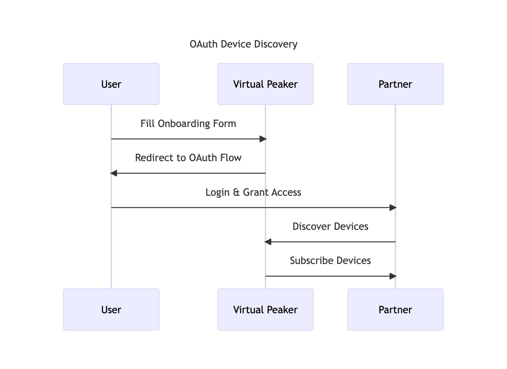
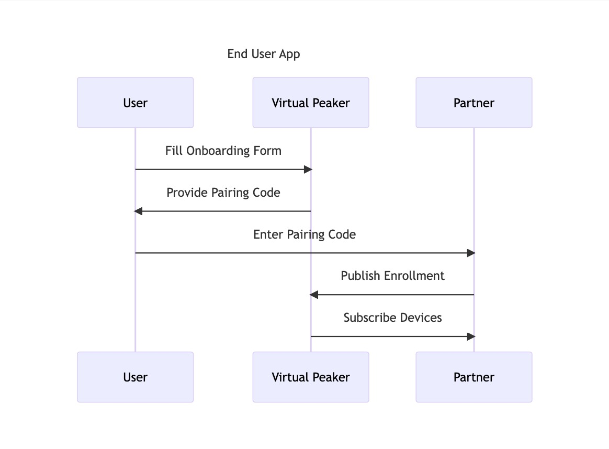
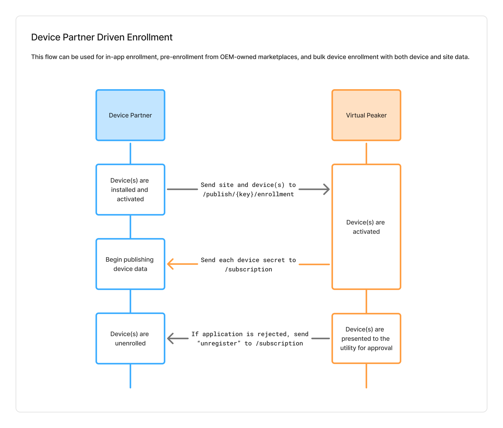
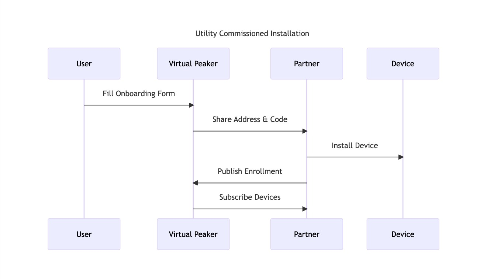

# Device Enrollment

Each device will be added to a program using one of the following flows. After a device is added, the VPP will call the `/subscription` endpoint on the Device Partner's API to enable device data publishing and share the `DEVICE_PUBLISH_SECRET`.

The flows most suitable for device owners to enroll devices are:
1. OAuth Device Discovery
2. Pairing Code Device Discovery

The flows most suitable for installers or program managers to enroll devices are:
1. Device Partner Driven Enrollment
2. Pairing Code Device Discovery

## About Pairing Codes

Pairing codes are used in some enrollment flows to link device enrollments to homeowner enrollments, ensuring accurate device association. The format is:

- **2 alphanumeric characters** denoting the pairing code prefix representing the program (e.g., `A1`)
- **5 random numeric characters** (e.g., `12345`)
- **1 check digit** (Luhn algorithm, calculated from the 5 random numeric characters, e.g., `5`)

**Example:** `A1123455`


### How to Validate a Pairing Code
1. Extract the first 2 alphanumeric characters to validate them against program pairing code prefix.
2. Extract the 5 random numeric characters (characters 3–7).
3. Calculate the Luhn check digit using the standard algorithm.
4. Compare the calculated digit to the last digit (character 8).

The device partner can validate the pairing code to provide immediate feedback. The VPP's API can perform the same validation upon receipt of a pairing code.

## OAuth Device Discovery

In this flow, a device owner fills out an enrollment form hosted by the VPP, then logs in to their Device Partner account to grant the VPP permission to access and control their devices.

The OAuth device discovery flow works as follows:
1. The device owner fills out an onboarding form on the VPP's site.
2. At the end of the form, the device owner is redirected to the Device Partner's OAuth authorization page via a link.
3. The user logs into the Device Partner's app and grants OAuth access permissions.
4. The Device Partner app completes the OAuth authorization code flow, exchanging the code for an access token.
5. Using the access token, the Device Partner calls their API to retrieve the user's devices.
6. The Device Partner associates the devices with the correct VPP program in their backend and completes any other required internal onboarding logic.
7. The Device Partner completes the OAuth callback to the VPP.
8. The VPP discovers devices using the OAuth token provided.
9. The VPP subscribes to devices for data publishing and provides a DEVICE_PUBLISH_SECRET.

The VPP creates a unique `client_id` for each utility program. This ID is passed in the OAuth link to associate devices with the correct program.

[](../../static/diagrams/oauth-device-discovery.png)

When a customer onboards via the OAuth flow, the VPP directs them to a URL in the format below with:

* The Device Partner's domain substituted for example.com
* The VPP's domain substituted for gravity.example.com
* The `client_id` of the program the user is onboarding to
* A state generated by the VPP to track the flow
* The scopes required within the Device Partner's system
* `access_type=offline` to indicate that a refresh token should be provided ([reference](https://developers.google.com/identity/protocols/oauth2/openid-connect#access-type-param))

```
https://example.com/oauth2/authorize?access_type=offline&response_type=code&redirect_uri=https%3A%2F%2Fgravity.example.com%2Foauth2%2Fcallback&client_id={}&state={}&scope={}
```

## Pairing Code Device Discovery - End User App

In this flow, a device owner fills out an enrollment form hosted by the VPP, which then presents them with a pairing code. The device owner then informs the Device Partner of their pairing code, which the Device Partner sends to the VPP with information about the device owner's devices. The VPP uses the pairing code to match the devices to the correct enrollment form data.

The pairing code device discovery flow works as follows:
1. The device owner fills out an onboarding form on the VPP's site.
2. The form provides them with a [pairing code](#about-pairing-codes) and instructions to enter it in the Device Partner's app.
3. The device owner enters the pairing code in the Device Partner's app, and the Device Partner publishes a device enrollment event to the VPP's API.
    1. The publish event includes the pairing code, allowing the VPP to match the devices to the correct enrollment form data.
    2. If multiple devices are enrolled for this device owner, the Device Partner sends multiple publish payloads with the same pairing code.
4. The VPP subscribes to each device for data publishing and provides a `DEVICE_PUBLISH_SECRET`.

Each utility program is assigned a different pairing code prefix that Device Partners can use to identify or confirm which program a device owner is joining.

[](../../static/diagrams/pairing-code-device-discovery.png)

## Device Partner Driven Enrollment

Device partner driven enrollment is a flow that can be used when the Device Partner has enough information about both the devices and the site to form a complete record in the VPP platform. This includes data such as the device UID, the service address, and the device owner's contact information.

The Device Partner can use this flow to proactively enroll devices through the Device Partner's app/website, pre-enroll a device purchased directly from the Device Partner, and bulk enroll devices that are transferred to the VPP.

1. The Device Partner publishes an enrollment message containing information about the site and each of the eligible devices. This enrollment message uses the program-specific credentials for the appropriate program.
2. The VPP subscribes to the devices for data publishing and provides a `DEVICE_PUBLISH_SECRET` for each.
3. If the enrollment application is approved, there will be no change. If the enrollment application is rejected by the utility, the VPP will unsubscribe from data publishing.

[](../../static/diagrams/device-partner-driven-enrollment.png)

## Service Address Device Discovery
The [device partner driven enrollment](#device-partner-driven-enrollment) flow is recommended in place of this flow.

The service address device discovery flow works as follows:
1. The device owner fills out an onboarding form on the VPP's site.
2. The utility reviews the submission and approves it if eligible.
3. The VPP informs the Device Partner of the service address and provides a [pairing code](#about-pairing-codes).
4. The Device Partner installs and activates the device.
5. When the installation is complete, the Device Partner publishes a device enrollment event to the VPP.
    1. The publish event includes the pairing code, allowing the VPP to match the devices to the correct enrollment form data.
    2. If multiple devices are enrolled for this device owner, the Device Partner sends multiple publish payloads with the same pairing code.
4. The VPP subscribes to each device for data publishing and provides a `DEVICE_PUBLISH_SECRET`.

[](../../static/diagrams/service-address-device-discovery.png)
