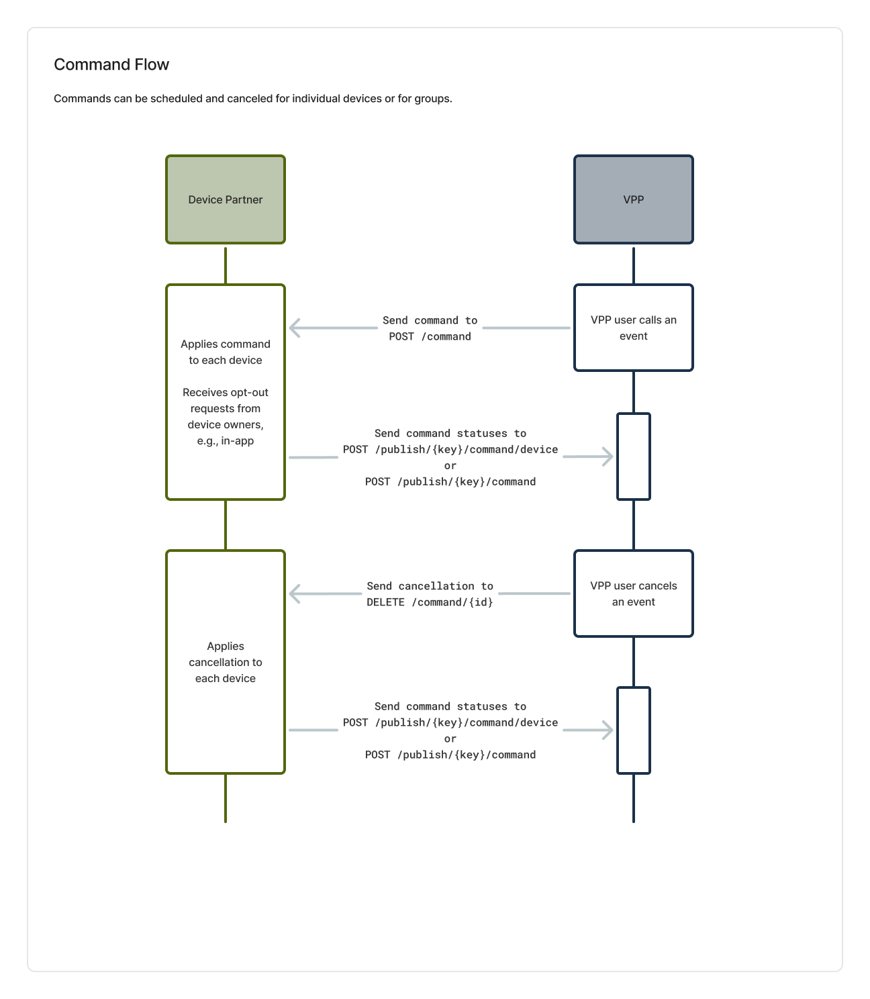

# Demand Response Commands

## Scheduling and Canceling

When a utility sends a command using the VPP's platform, the VPP [sends a command to the Device Partner](#operation/sendCommand) targeting a specific device or a group (if group management is supported). See [Device Type Specifications](/Integration%20Components/device-type-specifications) for the commands for each device type. 

As not all device models support all commands, while building the integration, the Device Partner must inform the VPP of which models support which commands. The types of commands accepted must be consistent per device type + kind. For example, if the Acme Corporation is a device partner who sets up a hot water heater (kind = `HWH`) with a model name of ACME1000 (type = `ACME1000`), all ACME devices of kind `HWH` and type `ACME1000` must support the same set of commands, but this set can be different than the command set supported by model `ACME1001`.

Throughout the duration of a command, devices continue to send data to the VPP. Commands also [publish their status](./vp-api.html#operation/publishCommand). For group commands, an individual device may need to report that it opted out (separate from the status of the command status), which it reports via the [device command status endpoint](./vp-api.html#operation/publishDeviceCommand).

The VPP can cancel any command that has been sent to a Device Partner using the [cancel endpoint](#operation/cancelCommand). The VPP may cancel active commands at any point during their duration. The Device Partner should immediately return devices to normal operating modes when a cancellation command is received.

Commands are sent from the VPP to the Device Partner at most 60 seconds before the start time, regardless of the VPP interface supporting program managers scheduling events hours or days in advance. The Device Partner must be able to accept both individual and group commands simultaneously for a given device.

## Device Data for Events

The active operating mode of a device must align with the requested command mode if the device is participating in an event. For example, a water heater cannot report it is in 'NORMAL' mode if it is actively participating in a demand response event that calls for a ‘SHED’ (but it can if it has opted out of the event). The current mode should be updated accordingly as commands begin and end. Throughout each event, enrolled devices continue publishing telemetry data to the VPP's platform through the standard publishing endpoints.

Individual devices report opt-outs via the VPP endpoint [publish device command status](./vp-api.html#operation/publishDeviceCommand). For group commands, individual devices report opt-out status, as needed, via the Device Partner endpoint [command opt-out](./vp-api.html#operation/commandOptOut).

Properly syncing modes and command statuses is crucial for accurate measurement and verification of demand response performance. The Device Partner integration must maintain consistency between the active command, device mode, and device command status.

## Opting Out of Events
For demand response events targeting individual devices, opt-out status should be reported using the VPP endpoint [publish device command status](./vp-api.html#operation/publishDeviceCommand) endpoint.

This allows the Device Partner to share the specific UID of the device that has opted out. The payload should include the UID along with a status of \"OPT_OUT\" and relevant timestamp.

For group commands, the group-level Device Partner endpoint [command opt-out](./vp-api.html#operation/commandOptOut) should be used, and not the individual device opt-out endpoint. The group command status should be updated to \"OPT_OUT\" to indicate a specific or set of specific devices in the group has opted out.

The Device Partner API needs to implement both individual and group opt-out flows:
* Individual devices: Report opt-out via the VPP endpoint [publish device command status](./vp-api.html#operation/publishDeviceCommand)
* Group commands: Report that particular devices within a group have opted out via group-level Device Partner endpoint [command opt-out](./vp-api.html#operation/commandOptOut)

Properly reporting opt-out status at both the individual device and group level allows the VPP to update event logs and measurement & verification accordingly.
